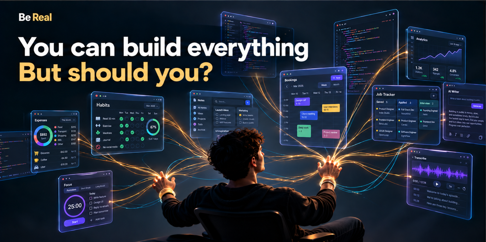

**An honest reality check for the projects you keep meaning to finish.**

The first few days of building can feel effortless. Then the prototype works, the novelty fades, and the remaining work starts to look very different: finding customers, deciding how the product should behave, handling failures, selling it, and supporting it.

Be Real helps you decide whether that commitment is worth making. It researches the opportunity, looks at your actual progress, and compares your projects against the time and energy you really have.

Sometimes the answer is to keep going. Sometimes it is to narrow the product, keep it for yourself, or park it.

## Install

```sh
npx skills add shankster/be-real --skill be-real -g
```

Choose the coding agents you use. Works with the Skills CLI targets for **Claude Code, Codex, Cursor, GitHub Copilot, Gemini CLI, OpenCode, Cline, and Windsurf**. Omit `-g` to install for the current project only.

Then ask your agent:

> Use Be Real to assess this project alongside my other projects. Help me choose what deserves my time and what to park.

In Codex, you can invoke it directly with `$be-real`. Other agents can expose their own skill picker or invocation command.

## What Be Real helps you answer

| Question | What it looks at |
| --- | --- |
| **Does anyone need this?** | Evidence of the problem, existing alternatives, demand, willingness to pay, and access to likely buyers. |
| **Can this compete?** | Actual customer overlap, differentiation, switching costs, and competitor traction—with sources for revenue or market-share claims when available. |
| **What is left beyond the demo?** | Product and system design, reliability, onboarding, delivery, payments, marketing, sales, maintenance, and support. |
| **How much effort would it take me?** | What you have made usable in recent months, the time and rework involved, your AI-assisted workflow, and your experience with each required task. |
| **Could it become worth the effort?** | Conditional pricing, acquisition, operating-cost, and payback scenarios, including slow or no sales. |
| **Does it deserve a place in my life now?** | Your other projects, income goals, protected commitments, available hours, and willingness to operate the product after the novelty wears off. |

Research findings come with evidence and uncertainty. A competitor's funding is not treated as revenue, and an unverified estimate is not presented as a fact. Be Real explains why a product may be competition, then asks you to verify the overlap and explain any advantage the comparison missed.

## One shared budget. One or two priorities.

Three promising projects still compete for the same person's attention.

Be Real recommends **one priority by default and at most two**, with reasons for what to park and conditions for revisiting it. An extra experiment has to earn its place alongside everything else.

It checks **this month's remaining capacity and next month's capacity separately**. Travel, family responsibilities, study, caregiving, recovery, and other commitments outside work can change the recommendation. Maintenance, customer delivery, selling, learning, and a realistic buffer all count toward the same budget.

A month with no capacity can mean no new project work. It does not automatically become a longer deadline for every project.

## Estimates grounded in your progress

Fast code generation does not tell us how long it takes to arrive at the product you intend.

Be Real looks at time spent defining behavior, making design decisions, evaluating results, integrating pieces, and revising what did not work. It uses comparable outcomes you have actually delivered where that evidence exists.

It also treats proficiency as task-specific. Engineering experience does not establish that you can acquire customers, write effective offers, run sales calls, or support a product at the same pace.

Missing evidence stays visible. A date for finishing a test is not a promise of a first sale.

## A conversation, not a giant questionnaire

Be Real starts with the context already available and asks a few numbered questions at a time. You can request a quick provisional assessment or work through the evidence in more depth.

You should come away with:

- A clear recommendation: continue, narrow, keep for personal use, or park.
- The strongest evidence for that recommendation and what could change it.
- A comparison of competing projects and a shared monthly allocation.
- The few gaps that dominate the remaining effort and ongoing obligations.
- One useful next action within the chosen priorities—or a deliberate pause.

Tables and diagrams make comparisons easier to inspect. Interactive visuals are used when your agent supports them.

Candor applies to the plan and its assumptions. Limited capacity or difficulty managing attention is not treated as a character flaw.

## Pick up where you left off

Be Real can remember each project's expectations, progress, research, and decisions, plus a shared plan across projects. Different agents running as the same user on the same machine can reuse that local store.

It tells you where records will be saved before the first save. You can choose a conversation-only assessment instead.

| Platform | Default data location |
| --- | --- |
| macOS | `~/Library/Application Support/Be Real` |
| Linux | `$XDG_DATA_HOME/be-real` or `~/.local/share/be-real` |
| Windows | `%LOCALAPPDATA%\Be Real` or `~\AppData\Local\Be Real` |

To resume:

> Use Be Real to resume this project's assessment. Recheck this month's remaining capacity and next month's commitments before recommending more work.

Records remain local. Another computer, a container, WSL, or a cloud agent may have a separate filesystem. `BE_REAL_HOME` lets you choose a common local storage directory; it does not provide cross-machine synchronization. See [how project memory works](skills/be-real/references/project-memory.md).

## What you need

- A coding agent that supports [Agent Skills](https://agentskills.io).
- Web access through your agent for current market research. Without it, Be Real can assess supplied evidence and marks current market claims as unverified.
- Python 3.10+ and filesystem access for optional local memory. Without them, the assessment continues in the conversation.

The [Skills CLI](https://github.com/vercel-labs/skills) requires Node.js 22.20+. No particular MCP server, paid integration, or visualization plugin is required. Add `--copy` to the installation command if symlinks are unavailable.

Installation compatibility does not guarantee identical model behavior across agents. [Validation status and contributor instructions](docs/distribution.md) document the checks and remaining limits.

---

[Skill instructions](skills/be-real/SKILL.md) · [MIT License](LICENSE)
